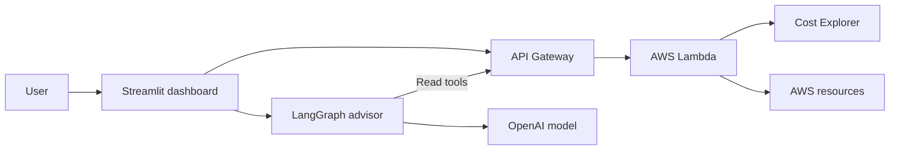

# AWS Cost Optimizer

Explore AWS spending, inspect cloud resources, and get AI-assisted cost recommendations from a Streamlit dashboard.

## Overview

AWS Cost Optimizer brings billing trends and resource inventory into one place. The dashboard calls a serverless AWS backend, while an AI advisor uses tools to retrieve cost and inventory data for its recommendations.

The current capabilities, setup steps, and limitations are documented below.

## Features

- **Cost dashboard:** total spend, daily average, service breakdowns, and daily trends with a seven-day moving average.
- **Resource inventory:** EC2, RDS, S3, Lambda, ECS, ElastiCache, and NAT Gateways.
- **Resource actions:** start or stop supported compute resources, and terminate or delete selected resources through the Services page.
- **AI advisor:** conversational recommendations using six tools for cost summaries, EC2, RDS, S3, Lambda, and NAT Gateways.
- **Infrastructure code:** Terraform definitions for Lambda, API Gateway, IAM, and CloudWatch logs.

## Technology

| Component | Tools |
| --- | --- |
| Interface | Python, Streamlit |
| Charts and data | Plotly, pandas |
| AI advisor | LangChain, LangGraph, OpenAI |
| AWS backend | Lambda, boto3, Cost Explorer |
| API | API Gateway REST API |
| Infrastructure | Terraform |

## Architecture



The dashboard uses HTTP requests to `API_GATEWAY_URL`. AWS SDK calls run inside Lambda using its execution role. Configuring AWS credentials on your laptop alone does not connect the dashboard.

## Getting started

### Prerequisites

- Python 3.10 or later and `pip`.
- An AWS backend compatible with `lambda_/handler.py`, with access to Cost Explorer and the resources you want to inspect.
- An OpenAI API key for AI features; the cost and inventory pages do not require one.
- AWS CLI credentials and Terraform 1.5 or later if you plan to work on the infrastructure.

### Install

From the repository root:

```bash
python3 -m venv .venv
source .venv/bin/activate
python -m pip install -r requirements.txt
cp .env.example .env
```

On Windows PowerShell, use `py -m venv .venv`, `.venv\Scripts\Activate.ps1`, and `Copy-Item .env.example .env` for the corresponding steps.

### Configure

Edit `.env` with your backend URL and, optionally, your OpenAI API key:

```dotenv
APP_TITLE="AWS Cost Optimizer"
AWS_REGION=us-east-1
API_GATEWAY_URL=https://YOUR_API_ID.execute-api.YOUR_REGION.amazonaws.com/dev/optimize
OPENAI_API_KEY=
OPENAI_MODEL=gpt-4o
```

The URL above is a placeholder. Replace it with your actual `/optimize` endpoint. Keep `.env` local; Git ignores it.

| Setting | Purpose |
| --- | --- |
| `APP_TITLE` | Home page and sidebar title |
| `AWS_REGION` | Default region used by the API client |
| `API_GATEWAY_URL` | Required backend endpoint, including the stage and `/optimize` path |
| `OPENAI_API_KEY` | Enables AI features |
| `OPENAI_MODEL` | Model used by the conversational advisor; defaults to `gpt-4o` |

### Run

```bash
python -m streamlit run dashboard/app.py
```

Open `http://localhost:8501`. The connection panel checks the backend using its `ping` action. Without a configured endpoint, the app starts but cannot retrieve AWS data.

## Infrastructure

The `terraform/` directory contains the supplied backend infrastructure. Inspect it before deploying:

```bash
terraform -chdir=terraform init
terraform -chdir=terraform validate
terraform -chdir=terraform plan
```

**The current API method uses `authorization = "NONE"` and routes both read and destructive actions to Lambda.** Add authentication, matching client support, and suitably scoped permissions before deploying a backend connected to your resources. The dashboard also has no application login. This repository does not represent a hardened public deployment.

After deploying an appropriately secured backend, its URL is available through:

```bash
terraform -chdir=terraform output -raw api_gateway_url
```

Set that value as `API_GATEWAY_URL` in `.env`.

## Project layout

```text
aws-cost-optimizer/
├── README.md
├── .env.example
├── .gitignore
├── .streamlit/config.toml
├── requirements.txt
├── config/                 # Application settings
├── dashboard/
│   ├── app.py              # Cost overview
│   ├── pages/              # Resource management and AI advisor
│   └── utils/              # HTTP client, AI tools, formatting
├── lambda_/                # Billing, inventory, and resource actions
├── terraform/              # Backend infrastructure
├── scripts/
│   └── commit-files.sh      # One descriptive commit per project file
└── docs/
    └── github-setup.md      # Publishing this repository
```

## Current limitations

- Resource actions affect real AWS resources. Termination and deletion can remove resources and data.
- The home page converts the selected dates into a number of lookback days; the backend queries that many days ending today, rather than the exact selected historical range.
- Some inventory cost estimates use hardcoded rates. They are illustrative estimates, not quotes from a live pricing API.
- Several inventory queries do not paginate, so large accounts may have incomplete results.
- Service cost rows spanning multiple months are not consolidated by service.
- AI requests can send retrieved cost and resource information to the configured model provider. The advisor's tools retrieve data; resource mutations are exposed separately through the Services page.
- Dependencies specify minimum versions rather than a tested lockfile. Compatibility should be verified in your environment.

## Development

Check Python syntax without calling AWS:

```bash
python -m compileall -q config dashboard lambda_
```

For Terraform changes, run `terraform -chdir=terraform fmt -check` and `terraform -chdir=terraform validate` after initialization. Syntax checks do not validate cloud integrations or dependency compatibility.

See [the GitHub setup guide](docs/github-setup.md) for committing and publishing the repository.

Potential next steps include API authentication, a read-only mode, sample data for offline demos, inventory pagination, and automated backend tests.

